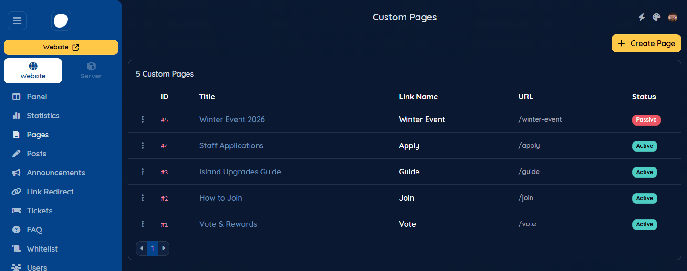
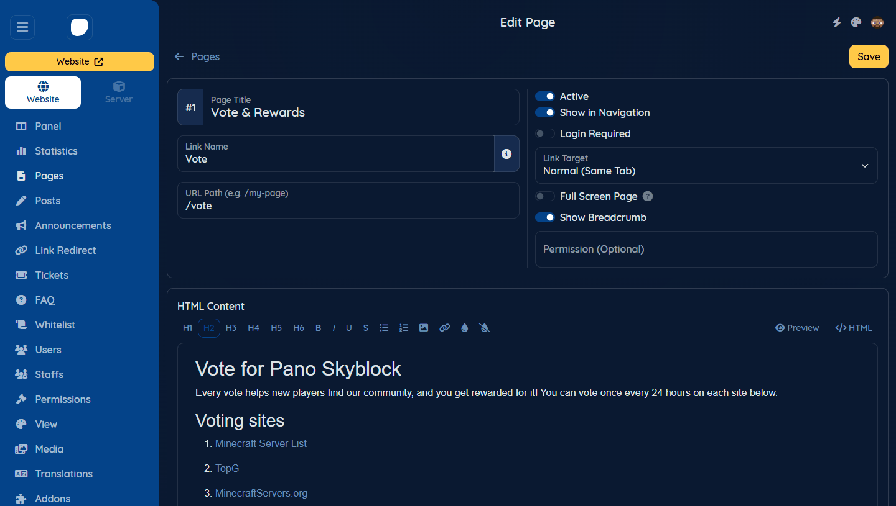

  
  <h1>Pages</h1>
  
<b>Add any page to your website, no code needed.</b>

  

    
    
    
  

Pages lets you add your own pages to your Pano website, like a vote page, a joining guide or staff applications. Write the content in the built-in editor, pick a link, and the page shows up in your site menu right away.

## ✨ Features
- 📝 **Built-in editor**: Write with headings, lists, links and images, or switch to HTML.
- 👀 **Preview**: See how the page looks before you save it.
- 🔗 **Your own link**: Choose the page address, like /vote or /join.
- 🧭 **Menu link**: Show the page in your site menu with a short name, or keep it off the menu.
- 🔒 **Members only**: Show a page only to logged-in players, or only to players with a chosen permission.
- 🖥️ **Full screen pages**: Hide the usual side parts for landing pages and big guides.
- ⏸️ **Active or inactive**: Prepare pages early and publish them when you are ready.

## 📸 Screenshots

<i>All your custom pages, their links and status in one list.</i>

<i>Edit the title, link, visibility and content on a single screen.</i>

## 🚀 Get started
1. Open your Pano panel and go to **Addons**.
2. Find **Pages** and click **Install**.
3. Open **Pages** in the panel, click **Create Page** and write your first page.

## 💬 Support
Questions or ideas? Join our [Discord](https://panomc.com/discord) or visit [panomc.com](https://panomc.com).

## 📄 License
Released under the MIT License.
